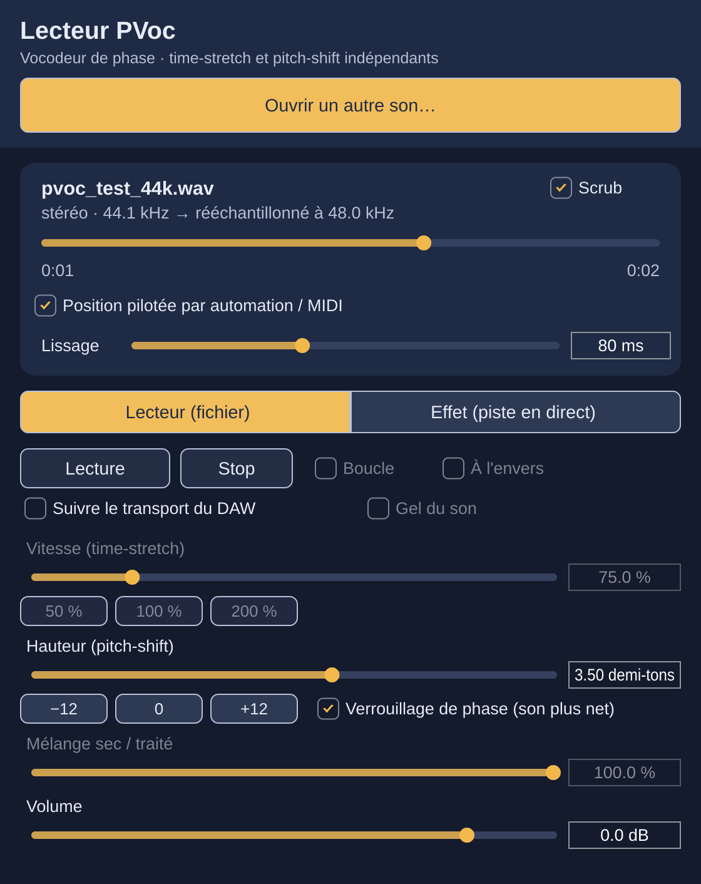
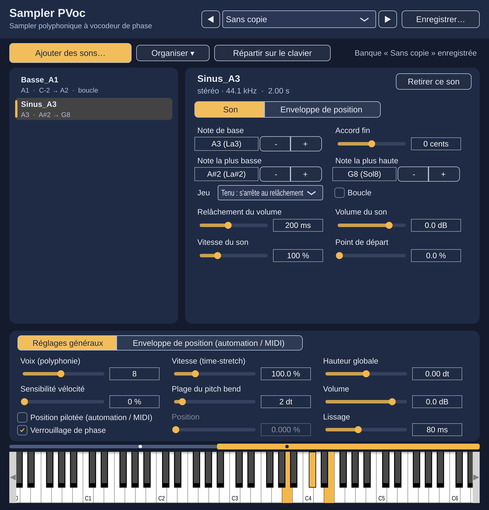
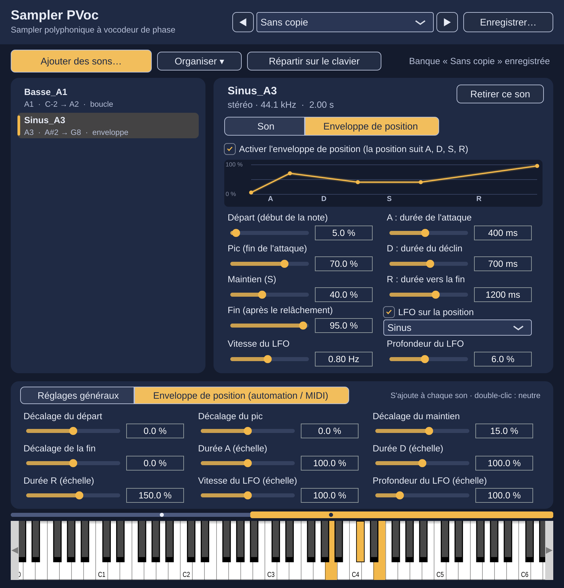

# Lecteur PVoc et Sampler PVoc — Audio Units (et VST3)

Plugin à **vocodeur de phase** : time-stretch et pitch-shift indépendants.
C'est la traduction en C++ du patch Pure Data `docs/pvoc-engine.pd` (même algorithme :
fenêtre de Hann de 2048 points, recouvrement 4, interpolation de `[tabread4~]`,
verrouillage de phase par les bandes voisines). Les sorties ont été comparées à celles de
Pd : l'écart spectral moyen est de 0,03 à 0,07 dB.



## Deux modes

**Lecteur (fichier)** — on charge un son (bouton « Ouvrir un son… » ou glisser-déposer) :
- vitesse de 0 à 400 % (0 = son figé), lecture à l'envers, boucle ;
- hauteur de −24 à +24 demi-tons ;
- « Suivre le transport du DAW » : la lecture démarre et s'arrête avec le DAW ;
- le son est rééchantillonné à la fréquence du projet (wav, aiff, flac, ogg, mp3, m4a…) ;
- le chemin du fichier et tous les réglages sont enregistrés avec le projet.

**Effet (piste en direct)** — traite l'audio de la piste :
- hauteur de −24 à +24 demi-tons ;
- « Gel du son » fige le son présent à cet instant ;
- mélange sec / traité.
- Latence : 5123 échantillons (~107 ms à 48 kHz), annoncée au DAW qui la compense
  automatiquement. Elle permet la transposition jusqu'à +24 demi-tons.

Tous les réglages sont automatisables dans le DAW.

## Composer avec la position (automation et MIDI)

Coche **« Position pilotée par automation / MIDI »** : la tête de lecture suit alors le paramètre
**Position** (0 à 100 %) au lieu d'avancer avec la vitesse. On entend le son glisser d'une position
à l'autre, comme avec le scrub. En mode effet, avec le gel activé, ce même paramètre parcourt les
dernières secondes enregistrées.

Le son est audible pendant la lecture : coche aussi **« Suivre le transport du DAW »** pour que
le plugin joue dès que tu lances le projet.

**Logic Pro**
- Automation : touche `A`, puis dans la piste choisis *Lecteur PVoc > Position* et dessine la courbe
  (ou mets la piste en mode *Latch* / *Touch* et bouge le curseur du plugin pendant la lecture).
- MIDI : *Logic Pro > Surfaces de contrôle > Apprendre l'assignation* (`Cmd + L`), clique sur le
  curseur de position du plugin, tourne le bouton de ton contrôleur, puis `Cmd + L` pour terminer.

Le réglage **Lissage** (0 à 1000 ms, 80 ms par défaut) fixe le temps de glissement de la position,
pour le scrub comme pour l'automation et le MIDI : 0 ms donne des sauts immédiats, des valeurs élevées
des déplacements lents et fluides. Il est lui aussi automatisable.

**Ableton Live**
- Automation : sous le titre du plugin, choisis *Lecteur PVoc > Position* dans le menu
  d'automation de la piste et dessine la courbe (ou active l'enregistrement d'automation).
  Si le paramètre n'apparaît pas, clique sur *Configure* dans le plugin puis bouge le curseur.
- MIDI : active le *MIDI Map Mode* (`Cmd + M`), clique sur le paramètre *Position* du plugin,
  tourne le bouton de ton contrôleur, puis `Cmd + M` pour terminer.

## Sampler PVoc (instrument)

Un second plugin, de type **instrument** : un sampler polyphonique dont chaque voix est un vocodeur
de phase. La note jouée règle la hauteur sans changer la durée ; la vitesse (time-stretch) reste
indépendante.





- **Ajouter des sons** : bouton « Ajouter des sons… » (sélection multiple) ou glisser-déposer de
  fichiers ou d'un dossier entier.
- **Zones** : chaque son a une **note de base** (la note où il sonne à sa hauteur d'origine) et une
  **plage** de notes. Une note dans le nom du fichier devient la note de base :
  `Piano_C3.wav`, `Voix_Do3.wav`, `Basse_F#1.aif`… (convention de Logic et d'Ableton : C3 = Do3 = note 60).
  Les plages sont réparties automatiquement entre les notes de base ; tu peux les régler à la main,
  ou cliquer sur « Répartir sur le clavier » pour tout recalculer. Des zones qui se chevauchent
  jouent ensemble (superposition).
- **Réglages par son** : note de base, plage, accord fin, mode de jeu (**Tenu** : s'arrête au
  relâchement avec un fondu réglable ; **One-shot** : joue jusqu'au bout), boucle, volume, vitesse,
  point de départ.
- **Réglages globaux (automatisables)** : nombre de voix (de mono à 16), vitesse, hauteur globale,
  sensibilité à la vélocité, plage du pitch bend, volume, verrouillage de phase, position pilotée
  et lissage (comme dans le Lecteur PVoc, appliqués à toutes les voix).
- **MIDI** : notes, vélocité, pédale de sustain, pitch bend, « All notes off ».
- **Enveloppe de position** (onglet du même nom, réglable pour chaque son) : un ADSR qui pilote la
  position de lecture, comme un scrub automatique.
  - **A** : au début de la note, la position part du **départ** et glisse vers le **pic** en la durée d'attaque ;
  - **D** : elle glisse ensuite vers la position de **maintien** en la durée de déclin ;
  - **S** : elle reste à la position de maintien tant que la touche est tenue ;
  - **R** : au relâchement, elle glisse vers la position de **fin** en la durée de relâchement ;
    le fondu de volume (« Relâchement du volume », onglet Son) commence quand la fin est atteinte.
  - En mode one-shot, il n'y a pas de maintien : A, D et R s'enchaînent.
  - Un **LFO** (sinus, triangle ou aléatoire doux, vitesse et profondeur réglables) fait osciller la
    position autour de l'enveloppe pour un son moins figé.
  - Quand l'enveloppe est active, elle remplace la vitesse et le point de départ du son.
- Le clavier en bas de la fenêtre joue le sampler à la souris et affiche les zones
  (la zone sélectionnée en jaune, sa note de base marquée d'un point).

- **Enveloppe de position pilotable** (onglet « Enveloppe de position (automation / MIDI) » en bas) :
  neuf paramètres automatisables et assignables à un contrôleur MIDI, appliqués à tous les sons dont
  l'enveloppe est active, par-dessus leurs propres réglages :
  - décalage du départ, du pic, du maintien et de la fin (−100 à +100 % de la longueur du son) ;
    le maintien se déplace en direct pendant une note tenue, avec un lissage d'environ 30 ms ;
  - échelle des durées A, D et R (10 à 1000 %, 100 % = durées réglées pour chaque son) ;
  - échelle de la vitesse et de la profondeur du LFO.
  Un double-clic sur un curseur le remet au neutre (0 % ou 100 %).
- **Banques de sons** (en haut de la fenêtre) : « Enregistrer… » sauve les sons et tous les réglages
  dans `Documents/Sampler PVoc/Banques`. Par défaut, les sons sont copiés dans un dossier
  « <nom de la banque> (sons) » à côté du fichier `.pvocbank` : la banque peut alors être déplacée ou
  copiée sur un autre Mac. La liste déroulante et les flèches ◀ ▶ passent d'une banque à l'autre ;
  « Ouvrir une banque… » ouvre une banque rangée ailleurs.
- **Organiser** : trier la liste par note de base, par nom de fichier, inverser l'ordre, ou activer le
  tri automatique par note (activé par défaut : chaque son ajouté prend sa place). Plusieurs sons
  ajoutés d'un coup arrivent dans l'ordre de la sélection.

Dans Logic Pro, il se trouve dans les instruments (*AU Instruments > Lecteur PVoc > Sampler PVoc*) ;
dans Ableton Live, dans *Plug-ins* comme instrument.

Les sons sont enregistrés dans le projet par leur chemin : garde-les au même endroit.

## Obtenir le plugin

### Sans Mac de développement : GitHub Actions

1. Crée un dépôt GitHub et envoie-y ce dossier.
2. L'onglet *Actions* lance « Construire l'Audio Unit (macOS) » : compilation universelle
   (Apple Silicon + Intel), tests, signature ad hoc et validation Apple (`auval`).
3. Télécharge l'artefact **PVoc-plugins-macOS** : il contient, pour chacun des deux plugins,
   l'AU, le VST3 et une application autonome.

### Sur un Mac avec Xcode

```
cmake -S . -B build -DCMAKE_BUILD_TYPE=Release
cmake --build build --config Release -j 8
```

Les plugins sont dans `build/LecteurPVoc_artefacts/Release/` (AU, VST3, Standalone).
JUCE 8 est téléchargé automatiquement (ou `-DJUCE_DIR=/chemin/vers/JUCE`).

## Installer l'Audio Unit

1. Copie `Lecteur PVoc.component` et `Sampler PVoc.component` dans `~/Library/Audio/Plug-Ins/Components/`
   (Finder : *Aller > Aller au dossier…*, puis colle ce chemin).
2. Le plugin n'est pas notarisé par Apple : retire la quarantaine dans le Terminal :
   ```
   xattr -dr com.apple.quarantine ~/Library/Audio/Plug-Ins/Components/"Lecteur PVoc.component"
   xattr -dr com.apple.quarantine ~/Library/Audio/Plug-Ins/Components/"Sampler PVoc.component"
   ```
3. Relance ton DAW. Dans Logic Pro : *Logic Pro > Réglages > Gestionnaire de plug-ins*,
   puis « Réinitialiser et rescanner la sélection » si le plugin n'apparaît pas.
   Il se trouve dans les effets audio, sous **Lecteur PVoc**.

Le VST3 s'installe de la même façon dans `~/Library/Audio/Plug-Ins/VST3/`.

**Astuce mode lecteur :** certains DAW ne font tourner les effets d'une piste vide que
pendant la lecture. Place le plugin sur une piste auxiliaire (bus), ou active
« Suivre le transport du DAW » et lance la lecture du projet.

## Développement

- `Source/PvocEngine.*` : le moteur (C++ pur, sans dépendance, sans allocation dans le thread audio).
- `Source/Resampler.h` : rééchantillonnage polyphasé (sinus cardinal + Kaiser, anti-repliement).
- `Source/PluginProcessor.*`, `Source/PluginEditor.*` : le plugin JUCE.
- Tests : `cmake -S . -B build-tests -DPVOC_TESTS=ON`, puis lancer `pvoc_effect_test`
  (moteur : latence, hauteur, gel, mélange) et `pvoc_plugin_test` (plugin complet).

JUCE est distribué sous double licence (AGPLv3 ou licence commerciale) :
un usage personnel ne pose aucun problème.
